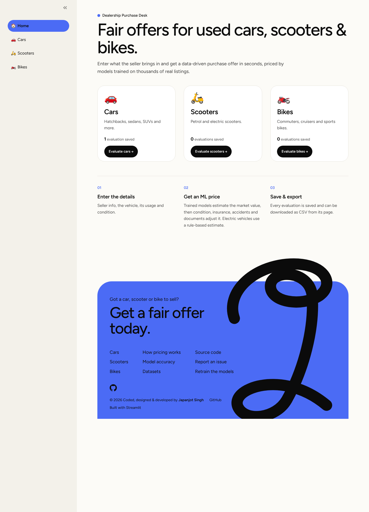
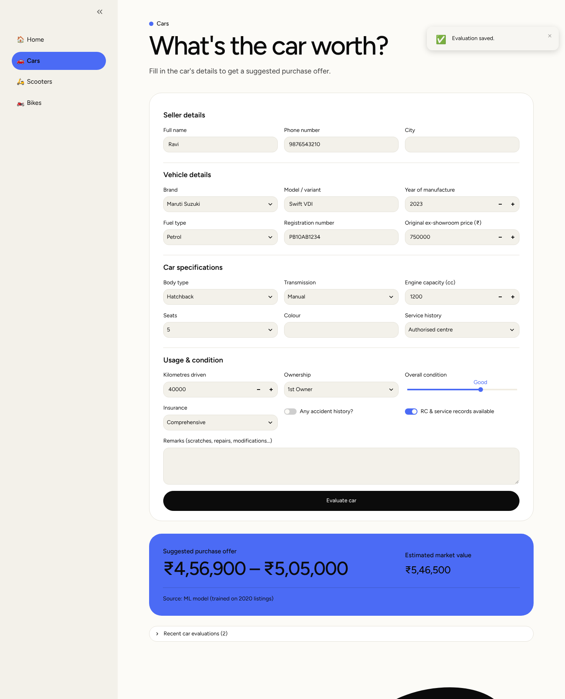

# ML Dealership Price Prediction

A Streamlit web app for a dealership that **buys second-hand cars, scooters and bikes**.
Staff enter the seller's and vehicle's details on a dedicated page for each vehicle type,
and the app returns an estimated market value and a suggested purchase offer. Every evaluation is saved for later review.





## Features

- **One web app, separate pages**: Home, Cars, Scooters and Bikes, using Streamlit's `st.navigation`.
- **Vehicle-specific inputs**
  - **Cars**: body type, transmission, engine cc, seats, colour, service history
  - **Scooters**: engine cc / battery kWh (electric), brakes, colour, tyre condition
  - **Bikes**: bike type, engine cc, brakes, gears, colour, aftermarket modifications
- **Common inputs**: seller name/phone/city, brand, model, year, fuel type, registration number,
  original ex-showroom price, km driven, ownership, condition, insurance, accident history, documents, remarks.
- **Validation**: required fields, phone format, positive price.
- **Valuation**: uses a trained ML model if one is present, otherwise a rule-based estimate.
- **History**: submissions are saved to `data/submissions/<type>s.csv`, shown on each page and downloadable as CSV.

## Project structure

```
.
├── app.py                 # Entry point: builds the multipage navigation
├── views/
│   ├── home.py            # Landing page with links and counts
│   ├── cars.py            # Car purchase form
│   ├── scooters.py        # Scooter purchase form
│   └── bikes.py           # Bike purchase form
├── src/
│   ├── config.py          # Dropdown options (brands, fuel types, ...)
│   ├── components.py      # Shared form sections, validation, results display
│   ├── features.py        # Form inputs -> model features (shared by app and training)
│   ├── valuation.py       # Price estimation (ML models + rule-based fallback)
│   ├── footer.py          # Site-wide footer
│   ├── theme.py           # Global CSS, page header and result card
│   └── storage.py         # Save/load submissions as CSV
├── training/
│   ├── datasets.py        # Load and clean the raw datasets
│   └── train.py           # Train, evaluate and save the models
├── data/raw/              # Training datasets (CSV)
├── models/                # Trained models + metrics.json
├── .streamlit/config.toml # Theme
└── requirements.txt
```

## Getting started

Requires Python 3.10+.

```bash
git clone https://github.com/sjapanjots/ML_Dealership_Price_Prediction.git
cd ML_Dealership_Price_Prediction
python -m venv .venv && source .venv/bin/activate   # Windows: .venv\Scripts\activate
pip install -r requirements.txt
streamlit run app.py
```

Then open http://localhost:8501.

## Deploying to Streamlit Community Cloud

1. Push the repo to GitHub (already done if you're reading this there).
2. Go to [share.streamlit.io](https://share.streamlit.io), sign in with GitHub and click **Create app**.
3. Choose **Deploy a public app from GitHub** and fill in:
   - **Repository:** `sjapanjots/ML_Dealership_Price_Prediction`
   - **Branch:** `main`
   - **Main file path:** `app.py`
4. Optional: open **Advanced settings** and pick Python **3.12** (anything 3.10+ works).
5. Click **Deploy**. Cloud installs `requirements.txt` and starts the app; `.streamlit/config.toml` (theme) is applied automatically.

No secrets or environment variables are required.

> **Saved evaluations are not permanent on Cloud.** The app's disk is wiped whenever it reboots, redeploys or
> goes to sleep after inactivity. Use the **Download all … evaluations (CSV)** button on each page to export
> the data regularly. For permanent storage, replace `src/storage.py` with a database (e.g. Google Sheets,
> Supabase or Postgres) and put its credentials in the app's **Secrets** settings, not in the repo.

## How the price is estimated

`src/valuation.py` exposes `estimate_price(vehicle_type, details)`.

1. **ML model:** predicts the market value of a vehicle in typical condition.
   - **Cars:** `models/car_model.pkl`. Uses brand, model name, age, km driven, owners, fuel, transmission,
     engine cc and seats.
   - **Scooters and bikes:** `models/two_wheeler_model.pkl`, one shared model with a scooter/bike flag
     (there isn't enough scooter data for a separate model). Uses brand, model name, age, km driven, owners
     and the ex-showroom price.
2. **Adjustments** for things the training data doesn't record: condition, insurance, accident history and
   missing documents.
3. **Rule-based fallback**, used for fuel types the model never saw (electric, hybrid) or if no model file
   exists. It starts from the original price and applies age depreciation, mileage, owners and the same
   adjustments.

The dealer's offer is the market value minus a 12% margin, shown as a ±5% range.
All factors are constants at the top of `src/valuation.py`, so they're easy to tune.

## The models

| | Car model | Scooter/bike model |
|---|---|---|
| Training rows | 6,921 | 1,055 (905 bikes, 150 scooters) |
| R² (20% hold-out) | 0.868 | 0.886 |
| Median error (hold-out) | 11.9% | 19.1% |

On the 133 two-wheeler test rows that have an ex-showroom price, the ML model's median error is **14.2%**,
compared with **20.5%** for the rule-based estimate. Full numbers are in `models/metrics.json`.

Algorithm: scikit-learn `HistGradientBoostingRegressor` on log(price), with one-hot encoded categories.

**Limitations**
- Both datasets were collected in 2020, so predictions reflect 2020 used-vehicle prices. Ages are measured
  relative to the listing year, so depreciation is applied correctly, but prices haven't been adjusted for
  inflation since then.
- No electric vehicles in either dataset, so electric and hybrid vehicles use the rule-based estimate.
- Only about 150 scooters, mostly Honda Activa, so scooter predictions are less reliable.

### Datasets

| File | Source | Rows |
|---|---|---|
| `data/raw/cars_cardekho.csv` | "Vehicle dataset from CarDekho" (Nehal Birla, Kaggle), `Car details v3.csv`, via the [chandanverma07/DataSets](https://github.com/chandanverma07/DataSets) mirror | 8,128 |
| `data/raw/two_wheelers.csv` | "Motorcycle dataset" (Nehal Birla, Kaggle), via the [YBI-Foundation/Dataset](https://github.com/YBI-Foundation/Dataset) mirror | 1,061 |

### Retraining

```bash
pip install -r requirements.txt
python -m training.train
```

This retrains both models, prints the evaluation, and overwrites `models/*.pkl` and `models/metrics.json`.
To use newer data, replace the CSVs in `data/raw/` (same columns) and update `DATA_REFERENCE_YEAR`
in `training/datasets.py`.

> `scikit-learn` is pinned in `requirements.txt` because pickled models only load reliably with the
> version they were saved with. If you upgrade it, retrain the models. Only load model files you trust,
> since unpickling can run arbitrary code.

## License

See [LICENSE](LICENSE).
